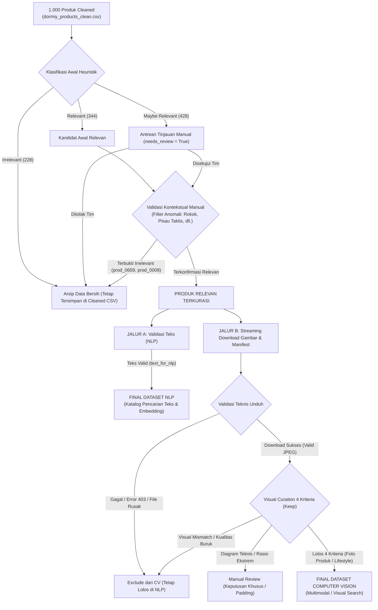

# Kriteria Kurasi Dataset Final - Proyek DORMIY

**Dokumen Standar Kurasi Data untuk NLP dan Computer Vision**
- **Proyek:** DORMIY (Search & Recommendation System Inventaris Asrama RTB)
- **Dataset Acuan:** `data/processed/dormiy_products_clean.csv` (1.000 produk, 23 kolom) & `data/processed/image_download_manifest.csv` (20 pilot records)
- **Status Dokumen:** Standar Resmi Kurasi Dataset (Final Dataset Curation Criteria)

---

## 1. Latar Belakang & Pemahaman Domain Dataset

Dataset dasar proyek DORMIY diekstraksi dari **Shopify Product Catalogue** yang merupakan **dataset proxy / eksternal katalog e-commerce publik**, bukan inventaris fisik gudang asrama RTB yang sebenarnya. 

Oleh karena itu:
1. Tidak semua produk e-commerce relevan dengan kebutuhan inventaris fasilitas asrama (dormitory inventory).
2. Di antara produk yang secara kategori awal dinilai relevan, **tidak semua produk otomatis memiliki gambar yang representatif atau layak** untuk pelatihan model Computer Vision (misalnya: gambar sketsa teknis, kemasan luar, atau rasio aspek ekstrem).
3. **Persyaratan dataset untuk Natural Language Processing (NLP) dan Computer Vision (CV) berbeda secara fundamental**:
   - Model NLP/Pencarian Teks dapat memanfaatkan data selama judul, deskripsi, dan metadata tekstualnya valid dan bermakna, bahkan jika produk tidak memiliki gambar atau gambarnya tidak layak untuk Computer Vision.
   - Model Computer Vision / Multimodal mewajibkan adanya aset gambar berkualitas tinggi, sudut pandang realistis, tidak rusak, dan benar-benar merepresentasikan wujud fisik produk.

Untuk menjaga integritas dan ketertelusuran data (*data lineage*), **tidak ada baris data yang dihapus dari dataset raw (`data/raw/shopify_sample_1000.csv`) maupun cleaned (`data/processed/dormiy_products_clean.csv`)**. Pemilahan dataset dilakukan secara logis melalui segmentasi kandidat (*subset filtering*).

---

## 2. Bagian A: Product-Level Curation (Kurasi Tingkat Produk)

### 1. Pembedaan Label Heuristik Otomatis vs Penilaian Relevansi Manual
Dalam proses kurasi DORMIY, sangat penting membedakan dua tingkatan evaluasi relevansi:
1. **`relevance_label` (Klasifikasi Awal Otomatis / Heuristik pada Proses Cleaning):**
   - Merupakan label aturan kasar (*rule-based heuristic*) yang diterapkan pada script `05_data_cleaning.py` berdasarkan pemetaan kategori utama e-commerce.
   - Menghasilkan 344 `Relevant`, 428 `Maybe Relevant`, dan 228 `Irrelevant`.
   - **Label `Relevant` awal ini tidak otomatis menjamin produk masuk ke dataset final**, melainkan hanya berfungsi sebagai filter penyaring awal kandidat.
2. **Penilaian Relevansi Manual (Visual & Contextual Manual Review):**
   - Merupakan evaluasi kurasi mendalam oleh tim manusia dengan memeriksa kesesuaian fisik gambar, teks judul, deskripsi, serta konteks regulasi lingkungan asrama.
   - **Hasil manual review berhak mengubah keputusan kurasi final** (misalnya mengubah status produk dari kandidat terpilih menjadi `Exclude`) **tanpa harus mengubah atau menghapus nilai awal kolom `relevance_label` pada file `dormiy_products_clean.csv`**.

### 2. Temuan Nyata dari Pilot Review: Anomali Label Awal
Pemeriksaan visual pada 20 sampel pilot membuktikan secara empiris bahwa produk yang lolos seleksi awal sebagai `Relevant` (karena tergolong dalam kategori `Home & Garden` atau `Hardware`) ternyata **dinilai `Irrelevant` setelah dilakukan inspeksi manual**:
- **`prod_0659` (Elements Ultimate Thin Single Wide Rolling Papers):**
  - *Kategori:* `Home & Garden`.
  - *Label Pembersihan Otomatis:* `Relevant`.
  - *Hasil Manual Review:* **Irrelevant (Exclude)**. Produk ini merupakan kertas linting tembakau/rokok yang merupakan barang konsumsi personal dan bertentangan dengan kebutuhan serta aturan umum asrama mahasiswa.
- **`prod_0008` (SOG SEAL XR 3.9" Folding Pocket Knife):**
  - *Kategori:* `Hardware`.
  - *Label Pembersihan Otomatis:* `Relevant`.
  - *Hasil Manual Review:* **Irrelevant (Exclude)**. Merupakan pisau lipat taktis militer yang melanggar regulasi keselamatan dan keamanan lingkungan asrama.

```
                      [ 1.000 Produk Cleaned ]
                                 │
         ┌───────────────────────┼───────────────────────┐
         ▼                       ▼                       ▼
    [ Relevant ]         [ Maybe Relevant ]        [ Irrelevant ]
    344 produk (34.4%)   428 produk (42.8%)        228 produk (22.8%)
    Penyaringan Awal     Area Review Kurasi        Bukan Kandidat Utama
    (Perlu Validasi)     Manual Bertahap           Tetap di Cleaned CSV
```

### 3. Kriteria & Contoh Berdasarkan Data Aktual

#### A. Kategori: Relevant (344 Produk / 34.4% pada Dataset Bersih)
- **Definisi:** Produk kandidat utama (*primary candidates*) inventaris fasilitas fisik asrama yang berasal dari 5 kategori inti: `Home & Garden`, `Hardware`, `Electronics`, `Furniture`, dan `Office Supplies`.
- **Kondisi Kelolosan:** Tetap wajib melalui verifikasi manual (atau filter kata kunci negatif) untuk memastikan tidak memuat barang konsumsi terlarang atau berbahaya.
- **Contoh Produk yang Lolos Validasi:**
  - `prod_0474`: *4 Tier Bookshelf, Bookcase, Etagere, Corner, For Office* (Furniture - rak buku kamar asrama).
  - `prod_0510`: *Ralis White & Oak Kitchen Cupboard - 5 Door* (Furniture - lemari dapur bersama).
  - `prod_0394`: *Nintendo Switch Power Cable* (Electronics - kabel daya/charger fasilitas rekreasi).
  - `prod_0719`: *STAPLER-HEAVY DUTY BOSTITCH 65 PREMIUM* (Office Supplies - perlengkapan kantor/ruang belajar).
  - `prod_0792`: *Big Green Egg SpeediClean™ Palmyra Bristle Long-Handle Grid Scrubber* (Home & Garden - sikat pembersih panggangan/dapur).
  - `prod_0238`: *TRUSCO 防振パット シートタイプ 300X300X10* (Hardware - bantalan peredam getaran mesin cuci/kulkas fasilitas).

#### B. Kategori: Maybe Relevant (428 Produk / 42.8%)
- **Definisi:** Produk yang berada di area batas (*borderline/ambiguous*) dan **dipertahankan untuk peninjauan manual bertahap** (*manual review*). Tidak langsung dimasukkan ke subset final tanpa verifikasi.
- **Karakteristik Data:**
  - Kategori sekunder: `Sporting Goods` (gym bersama vs alat berburu), `Arts & Entertainment` (alat musik bersama vs cinderamata pesta), `Health & Beauty` (P3K vs kosmetik personal), `Business & Industrial` (labeler barcode gudang vs mesin industri berat), `Toys & Games` (board games vs mainan balita), `Cameras & Optics` (kamera dokumentasi vs mikroskop industri), serta `Luggage & Bags` (tas darurat/kontainer penyimpanan).
  - Produk kategori utama yang memiliki indikasi suvenir/dekorasi personal (`needs_review = True`, 14 produk).
- **Contoh Data Aktual:**
  - `prod_0046`: *Bodyworx T-Bar Trainer for Machines* (Sporting Goods - perlengkapan kebugaran/gym bersama).
  - `prod_0005`: *Conn 62HI Bass Trombone Outfit* (Arts & Entertainment - instrumen musik fasilitas bersama).
  - `prod_0802`: *Brush Research Mfg. Helical Steel Tube Brush* (Hardware - sikat baja maintenance fasilitas teknis asrama).
  - `prod_0273`: *Sioux Tools Pistol Grip Handle Air Screwdriver* (Hardware - perkakas bengkel pemeliharaan gedung).
  - `prod_0001`: *Airplane Piggy Bank* (Home & Garden - celengan dekoratif personal, perlu keputusan tim apakah relevan untuk inventaris asrama).

#### C. Kategori: Irrelevant (228 Produk / 22.8%)
- **Definisi:** Produk yang jelas berada di luar lingkup fungsional dan operasional inventaris asrama.
- **Karakteristik Data:**
  - Berasal dari 8 kategori di luar ruang lingkup: `Vehicles & Parts`, `Apparel & Accessories`, `Animals & Pet Supplies`, `Food, Beverages & Tobacco`, `Baby & Toddler`, `Software`, `Services`, dan `Media`.
- **Contoh Data Aktual:**
  - `prod_0672`: *Safety 1st Pathways Home 2-piece Set, Highchair and Bassinet* (Perabot bayi/ranjang bayi).
  - `prod_0054`: *FORMAX FD 262 Single-Head Tabber* (Mesin industri percetakan surat massal).
  - `prod_0892`: *Phoenix Contact 1702018* (Komponen konektor sirkuit PCB industri).
- **Kebijakan Penyimpanan:** **Tetap dipertahankan di `dormiy_products_clean.csv`** dengan kolom `relevance_label = "Irrelevant"` dan `is_dorm_relevant = False`. Tidak ada data yang dihapus dari database.

---

## 3. Bagian B: Image-Level Curation (Kurasi Tingkat Gambar)

Berdasarkan inspeksi visual contact sheet pada 20 sampel pilot (`reports/figures/pilot_image_contact_sheet.jpg`), aset gambar produk memiliki variasi representasi visual dan kualitas yang sangat beragam.

### 1. Kesesuaian Gambar dengan Judul Produk (Visual Match)
- **Yes (Cocok):** Gambar menampilkan objek fisik yang secara tepat sesuai dengan judul dan kategori produk (contoh pada pilot: `prod_0474` rak buku, `prod_0719` stapler).
- **No (Tidak Cocok):** Gambar menampilkan produk yang berbeda dari judul/deskripsi (akibat broken URL CDN atau mismatch). Wajib di-**Exclude**.
- **Unclear (Ambigu):** Objek pada gambar terlalu buram, terhalang objek lain, atau tidak dapat dikenali secara pasti. Masuk antrean **Manual Review**.

### 2. Standar Kualitas Gambar (Image Quality)
- **Good (Layak):** Resolusi memadai, kontras tajam, pencahayaan seimbang, subjek utama berada di tengah (*centered*), dan latar belakang transparan telah dikompositkan secara bersih ke latar belakang putih (contoh: `prod_0792`, `prod_0235`, `prod_0510`).
- **Fair (Cukup):** Gambar masih dapat dikenali namun memiliki keterbatasan geometris atau visual minor, misalnya rasio aspek ekstrem (contoh: `prod_0569` gagang sapu berukuran 432x65 px, rasio ~6.6:1). Memerlukan penyesuaian khusus (padding/letterboxing) jika diproses oleh Vision Transformer.
- **Poor (Buruk):** Resolusi sangat rendah (< 150 px), distorsi piksel parah (*pixelated*), kompresi berlebih (*severe artifacting*), atau gambar rusak (*corrupted*). Wajib di-**Exclude**.

### 3. Klasifikasi Tipe Gambar (Image Type) & Prinsip Kontekstual
Tipe gambar **hanya merupakan salah satu faktor penilaian** dan tidak boleh dijadikan satu-satunya penentu mutlak:
- **Foto Packaging tidak otomatis dikecualikan:** Jika kemasan produk merupakan bentuk standar pengenalan inventaris di gudang (misalnya boks perlengkapan P3K, boks baterai, atau set perkakas dalam wadah koper aslinya), gambar kemasan tersebut **dapat diterima**. Sebaliknya, kemasan yang hanya berupa karton polos tanpa identitas barang fisik atau kemasan display rokok (`prod_0659`) wajib di-**Exclude**.
- **Foto Lifestyle tidak otomatis diterima:** Foto lifestyle yang memperlihatkan produk secara jelas dan proporsional dalam ruangan (seperti `prod_0474` rak buku sudut di samping sofa atau `prod_0510` lemari dapur) **sangat layak**. Namun jika foto lifestyle terlalu ramai (*cluttered*), di mana subjek utama tenggelam di antara dekorasi ruangan lain atau tertutup orang, maka foto tersebut masuk **Manual Review** atau di-**Exclude** agar tidak membingungkan ekstraktor fitur visual.

| Tipe Gambar | Definisi & Karakteristik Visual | Contoh Aktual | Evaluasi Kelayakan CV |
| :--- | :--- | :--- | :--- |
| **Product Photo (Isolated)** | Foto produk fisik tunggal atau set terisolasi pada latar belakang putih/netral. | `prod_0719` (stapler), `prod_0394` (kabel), `prod_0064` (6 bel meja) | **Prioritas Utama Baseline CV** jika subjek jelas. |
| **Lifestyle Photo** | Foto produk di dalam lingkungan ruangan/interior nyata. | `prod_0474` (rak sudut), `prod_0510` (lemari dapur) | **Layak jika subjek dominan**, namun perlu review jika background terlalu ramai. |
| **Product Photo (Packaging)** | Foto kotak kemasan luar produk eceran (*retail packaging*). | `prod_0659` (display box rolling papers) | **Tergantung Konteks**: Diterima untuk kit/wadah inventaris, ditolak jika sekadar boks luar generik/produk tak relevan. |
| **Diagram / Technical Drawing** | Sketsa teknis blueprint berdimensi, diagram garis CAD, atau infografis skematis bertulisan teks penunjuk fitur. | `prod_0741` (blueprint kabinet sudut berukuran inci), `prod_0751` (diagram anotasi scanner polisi) | **Tidak Layak untuk Baseline CV Foto Produk** (Menimbulkan bias sketsa non-fotografis dan noise teks OCR). |

### 4. Kriteria Kelayakan Lengkap untuk Status `Keep`
Sebuah entri dinyatakan berstatus **`Keep` (Masuk ke Dataset Final Computer Vision)** jika dan hanya jika memenuhi **seluruh 4 syarat berikut sekaligus**:
1. **Produk Terbukti Relevan Setelah Kurasi:** Produk lolos validasi kebutuhan asrama (baik dari label awal `Relevant` yang telah diverifikasi tidak bermasalah, maupun dari `Maybe Relevant` yang disetujui kurator).
2. **Visual Match Bernilai `Yes`:** Gambar terbukti secara visual menampilkan barang yang sesuai dengan judul dan deskripsi produk.
3. **Kualitas Gambar Layak:** `image_quality` bernilai `Good` (atau `Fair` yang telah disesuaikan rasio aspeknya melalui padding).
4. **Jenis Gambar Sesuai Kebutuhan Baseline CV:** Objek fisik barang tampak jelas sebagai foto nyata (bukan sketsa diagram teknis berdimensi, bukan infografis penuh teks, dan bukan foto lifestyle yang terlalu ramai/terdistraksi).

### 5. Aturan Penugasan Status (Recommended Action)
- **Keep:** Memenuhi ke-4 syarat kelayakan di atas (contoh pada pilot: `prod_0474`, `prod_0510`, `prod_0394`, `prod_0719`, `prod_0792`, `prod_0238`, `prod_0235`, `prod_0064`, `prod_0786`).
- **Manual Review:**
  - Gambar memiliki rasio aspek ekstrem (contoh: `prod_0569` gagang kayu 432x65 px).
  - Gambar berupa diagram teknis/blueprint padahal produknya sangat relevan (contoh: `prod_0741` lemari kabinet dapur).
  - Produk perkakas teknis yang perlu konfirmasi fungsi di asrama (contoh: `prod_0802` sikat tabung, `prod_0273` obeng angin).
- **Exclude:**
  - Gambar gagal diunduh atau file korup.
  - Gambar tidak cocok dengan judul (`visual_match == "No"`).
  - Kualitas gambar `Poor`.
  - Berasal dari produk yang dinilai `Irrelevant` untuk asrama (contoh: `prod_0659` rokok, `prod_0008` pisau taktis, `prod_0672` perlengkapan bayi, `prod_0054` mesin industri).

---

## 4. Bagian C: Strategi Dataset Final (Dual-Track Architecture)

Untuk mengakomodasi perbedaan kebutuhan antara pemrosesan bahasa alami (NLP) dan visi komputer (CV), proyek DORMIY menerapkan **Strategi Jalur Ganda (Dual-Track Architecture)**:

```
                      [ data/processed/dormiy_products_clean.csv ]
                               (1.000 Produk, 23 Kolom)
                                          │
                     ┌────────────────────┴────────────────────┐
                     ▼                                         ▼
         [ Jalur A: Dataset NLP ]                  [ Jalur B: Dataset CV ]
         Fokus: Teks & Semantik                     Fokus: Visual & Multimodal
         - Kandidat: Produk Relevan                 - Kandidat: Produk Relevan +
           (Terverifikasi Teks)                       Gambar Terverifikasi Layak
         - Teks: clean_title, text_for_nlp          - Gambar: High Quality, Foto Riil
         - Tidak wajib ada gambar                   - Wajib lolos 4 kriteria Keep
```

### Prinsip Utama Strategi:
1. **Zero Data Loss pada Source of Truth:**
   Dataset `data/raw/shopify_sample_1000.csv` dan `data/processed/dormiy_products_clean.csv` tidak pernah dipangkas barisnya. Keputusan kurasi direkam sebagai metadata subset atau kolom keputusan final.
2. **Pemisahan Kebutuhan NLP vs Computer Vision:**
   - **Kandidat Final NLP (Text Search & Recommendation):**
     Memerlukan representasi teks berkualitas (`clean_title`, `clean_description`, `text_for_nlp`, `brand_imputed`). Produk yang relevan secara fungsional **tetap dapat masuk ke kandidat NLP meskipun gambarnya tidak layak untuk baseline CV** (atau bahkan jika gambarnya gagal diunduh). Contoh konkret: `prod_0741` (lemari kabinet) memiliki teks yang sangat relevan untuk katalog pencarian furnitur asrama, sehingga valid untuk NLP meskipun gambarnya berupa blueprint teknis.
   - **Kandidat Final Computer Vision (Image Retrieval & Multimodal Search):**
     Memerlukan teks relevan dan gambar fotografis yang keduanya terverifikasi valid secara visual.
3. **Produk "Relevant" Tidak Otomatis Memiliki Gambar Layak:**
   Fakta empiris dari pilot review: Kategori produk yang relevan tidak menjamin ketersediaan foto produk fotografis e-commerce yang bersih.
4. **Perlakuan terhadap Produk "Maybe Relevant":**
   Produk dalam kelompok ini (428 produk) tetap dapat dievaluasi secara bertahap untuk dipromosikan ke dataset final jika fungsi inventarisnya terbukti dibutuhkan asrama.
5. **Kesadaran Proxy Dataset:**
   Karena dataset berasal dari Shopify publik, kurasi manual dan filtering kontekstual merupakan jembatan wajib untuk menyelaraskan katalog ritel dengan inventaris gudang asrama RTB.

---

## 5. Bagian D: Alur Kerja (Workflow) dari Data Bersih ke Dataset Final

Berikut alur kerja sistematis bertahap (*end-to-end workflow*) untuk menyaring 1.000 produk cleaned menjadi subset dataset final NLP dan Computer Vision:



### Tahapan Detail Workflow:

1. **Tahap 1: Partisi Logis Awal (Tingkat Dataset 1.000 Produk)**
   - Mengambil 1.000 produk dari `dormiy_products_clean.csv`.
   - Mengelompokkan berdasarkan `relevance_label` (344 Relevant, 428 Maybe Relevant, 228 Irrelevant).
2. **Tahap 2: Validasi Kontekstual Produk (Pembersihan Anomali)**
   - Menyaring produk dari kategori Relevant yang terbukti tidak sesuai aturan asrama (contoh temuan pilot: `prod_0659` rokok dan `prod_0008` senjata tajam).
   - Meninjau 83 produk `needs_review == True` dari kelompok Maybe Relevant.
   - Menghasilkan daftar *Produk Relevan Terkurasi*.
3. **Tahap 3: Pembentukan Dataset Final NLP (Jalur A)**
   - Mengekstrak teks dari *Produk Relevan Terkurasi*.
   - Memvalidasi kelengkapan `clean_title`, `text_for_nlp`, dan metadata pendukung (`brand_imputed`, `main_category`).
   - Produk berhak masuk dataset final NLP sekalipun gambarnya tidak layak untuk CV (seperti `prod_0741`).
4. **Tahap 4: Pengunduhan & Validasi Teknis Gambar (Jalur B)**
   - Menjalankan streaming download via `06_image_dataset_preparation.py` untuk produk relevan yang ditargetkan.
   - Mengompositkan transparansi ke latar belakang putih solid.
   - Mencatat status unduh dan metadata dimensi pada `image_download_manifest.csv`.
5. **Tahap 5: Kurasi Visual & Pembentukan Dataset Final Computer Vision**
   - Menilai kesesuaian gambar berdasarkan 4 kriteria kelayakan `Keep`:
     - Relevansi produk terkonfirmasi.
     - `visual_match == "Yes"`.
     - Kualitas gambar memadai (`Good` / `Fair` terpad).
     - Jenis gambar representatif secara fotografis (bukan diagram garis berdimensi atau infografis penuh teks).
   - Menyatukan pasangan data teks dan file gambar lokal yang lolos ke dalam dataset final multimodal (misal: `data/final/dormiy_multimodal_dataset.csv`).
